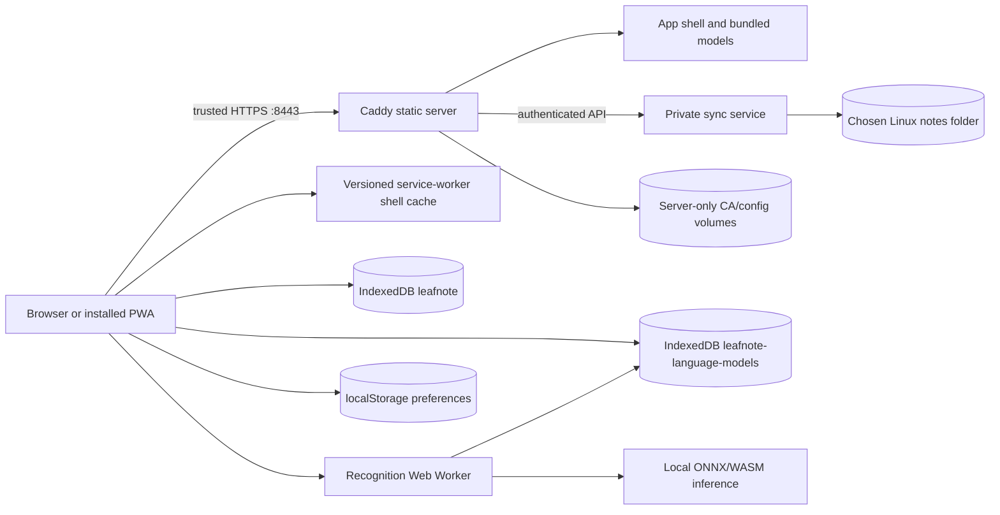
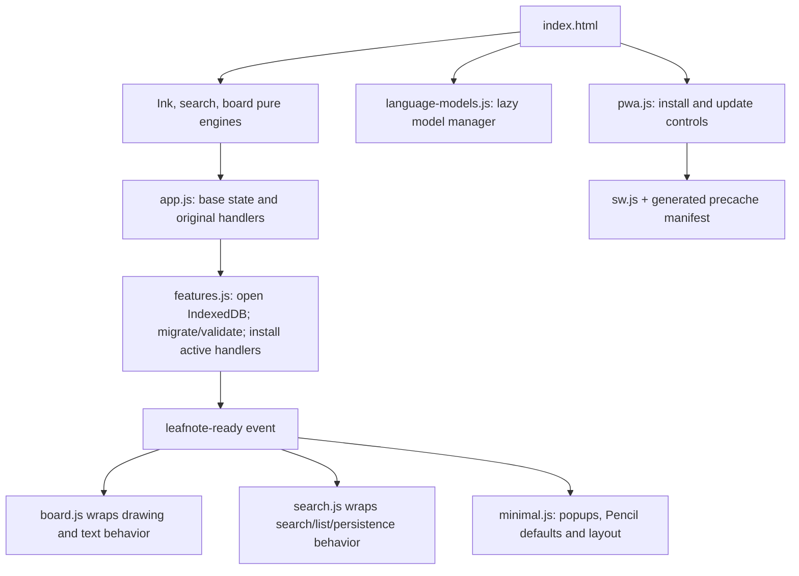
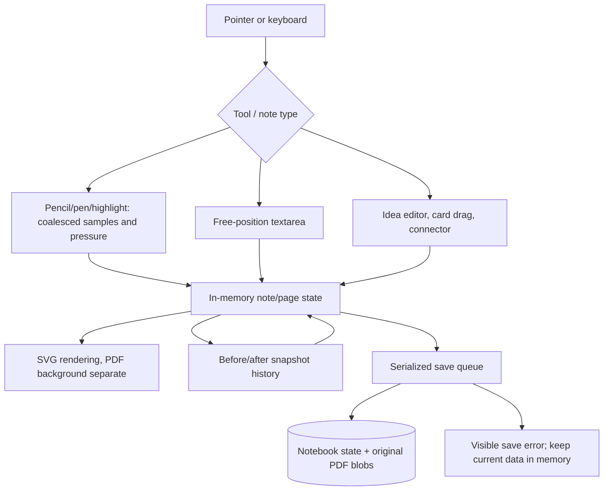
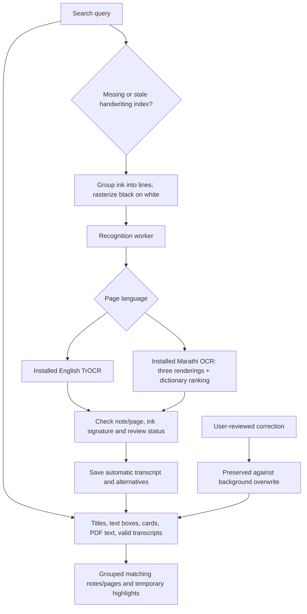
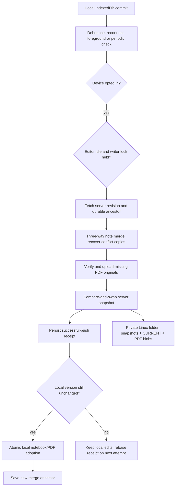
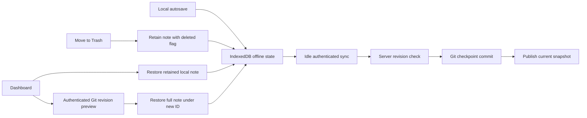

# Application flow and data boundaries

## Runtime overview



Notebook contents stay on the client until Server sync is enabled. Paired clients send authenticated snapshots and PDF originals through Caddy to the separate sync API and chosen server folder. The browser imports local PDFs and exports backups/downloads. Recognition consumes an RGBA line image in a worker on the client. Model source/licence links are informational; model installation fetches bundled files from the LAN server.

## Startup and script order



This is a buildless classic-script app with small ESM recognition/storage modules. `app.js` provides shared lexical bindings (`data`, `current`, `tool`, selectors, base functions). `features.js` replaces storage, drawing, export, undo, and note opening. Board and search modules wrap selected functions after readiness. Read the active override in `features.js` when a base function in `app.js` has the same name. This layering is documented rather than silently refactored during packaging.

## Editing, undo, and persistence



Coordinates are document-space values, independent of screen zoom. PDF annotations belong to a specific page. Pencil grade and opacity are retained as stroke fields. Formatting is plain text-box/card styling, not arbitrary rich HTML. Changing style preserves text, spacing, and undo history.

## Search and recognition



`search-engine.js` is the pure source of search records, normalization, line grouping, and ink signatures. `search.js` owns scheduling and the review UI. A transcript is stale when its recognition-relevant ink changes. Reviewed corrections survive recognizer upgrades. Marathi remains experimental; bundled sample checks are not an accuracy benchmark.

## Installation and updates

```mermaid
sequenceDiagram
  participant UI as App UI
  participant SW as Service worker
  participant Server as Local HTTPS server
  participant DB as Client IndexedDB
  UI->>SW: register
  SW->>Server: fetch complete versioned shell
  SW->>SW: cache all required shell files
  Note over SW: Install fails atomically if a required download fails
  UI->>UI: show offline-ready status
  Server-->>SW: later app version available
  SW->>SW: install new shell; wait
  UI->>DB: finish edit and await save
  DB-->>UI: saved
  UI->>SW: user-approved ACTIVATE_UPDATE
  SW->>SW: activate; remove older Leafnote shell caches only
  SW-->>UI: controller changed; reload saved app
```

The shell cache never stores note content or optional model assets. Models have their own install/remove lifecycle. The update handler refuses to reload if notebook persistence fails. Service-worker activation does not delete IndexedDB or layout preferences.

## Stored shapes

| Store                                 | Main contents                                                            | Owner               |
| ------------------------------------- | ------------------------------------------------------------------------ | ------------------- |
| `leafnote` / `state` / `notebook`     | notebooks, notes, PDF page metadata, text, ink, boards, transcripts      | `features.js`       |
| `leafnote` / `pdfs`                   | original imported PDF Blob by note ID                                    | `features.js`       |
| `leafnote-language-models` / `assets` | verified model/revision/file Blobs                                       | `model-storage.mjs` |
| `leafnote-language-models` / `models` | installed/removed state, revision, byte count                            | `model-storage.mjs` |
| `leafnote-shell-*` Cache API          | versioned static app runtime                                             | `sw.js`             |
| localStorage `leafnote-*`             | input, layout, writing, and text-style preferences; legacy recovery copy | app UI modules      |
| Docker `caddy_data`, `caddy_config`   | server TLS CA and Caddy metadata                                         | Caddy               |

`Note` includes stable ID, notebook ID, title, timestamps, favorite, paper, strokes and text boxes. PDF notes add page records and an original-file ID. Board notes add dimensions, nodes, and links. A stroke has color, width, opacity, pressure and sampled points; Pencil adds brush/grade. Text boxes and idea cards retain color, size and line height. Undo snapshots are in memory; exported backups carry persistent note/PDF data, not installed model files or shell caches.

Version 1.1 adds an optional shared-code sync API for one personal notebook. It does not provide multi-user accounts or live collaborative editing.

## Optional server synchronization (1.1)



`leafnote-sync` IndexedDB stores device opt-in, code, a stable device ID, the last server ancestor, and a pending receipt. It does not duplicate PDF bytes. The browser writer lock prevents two new app windows from independently overwriting the same profile’s full notebook. The server serializes one process’s metadata commits and rejects stale revisions. API paths are network-only and never enter the PWA shell cache. See SYNC.md for failure behavior and retention.

## Revision and recovery flow (1.2)



`server/git-history.mjs` executes fixed Git argument arrays with isolated configuration and disabled hooks. The private history folder is never served by Caddy. Snapshot commits retain complete note metadata plus immutable PDF hashes; originals stay in blobs. Startup checks Git workspace/revision identity and repairs a lagging snapshot pointer from a valid HEAD. `maintenance.js` is only loaded with the shell; it requests historical note content after the user opens Revision history. Soft deletion retains all local content/PDF bytes and flows through the same merge and sync engine. Protocol 2 fences clients that do not preserve tombstones.

## Thumbnail library (1.3)

`library.js` starts after the existing editor/search/minimal UI modules and shows the library overview by default. It reuses the existing filtered/search result buttons, so opening a card follows the same note/page navigation. A MutationObserver decorates list updates; IntersectionObserver defers thumbnails until near the viewport. `library-preview.js` builds safe read-only SVG for paper, pressure ink, positioned text, board cards, and connectors. Separate PDF.js tasks paint original pages underneath annotation SVGs, with two active jobs and a bounded cache of completed canvases. Editor render tickets and document state are untouched. The Grid/List preference is localStorage-only and is excluded from note sync and backups. Trash remains excluded by the existing list/search filters.

## Dashboard and page review build

`dashboard.js` displays measured metadata/PDF bytes and a separate browser-origin storage estimate. Paired clients read the private `/api/sync/storage` endpoint; `storage-info.mjs` counts regular files without following symlinks. The host mount path is supplied by Compose only to that authenticated response. Folder migration is a Linux helper command, never remote shell execution from browser input.

Ordinary notes retain their original first-page fields and add `extraPages`; PDFs retain their page array. The current page has an independent `paper` choice. `document-pages.js` reuses the one active editor between read-only neighboring page previews, preserving scroll position when activating a page. Page insertion and changed PDF bytes commit atomically through the existing save queue. `paper-engine.js` shares transparent ruling generation with PDF overlays and previews.

Permanent deletion retains only an ID/time entry in root `purged` markers and removes the current note/PDF reference. Three-way merge and server normalization union these markers so stale notes cannot return. Protocol 3 fences clients that do not preserve them. Prior Git revisions and immutable server PDF blobs remain available to historical restoration as new note IDs.

## Page ordering follow-up

Every page header owns explicit Add/Move/Delete callbacks for its displayed index. Selection positions are device-local preferences and do not create note revisions. Ordinary first-page fields are promoted/repacked with content, ruling, height, language and recognition metadata when page order changes; note ID, title, notebook and favorites remain attached to the document. PDF page tree order and per-page annotation arrays are changed in one atomic state/PDF transaction. Structural changes clear index-based undo stacks. Page deletion preserves at least one page; earlier versions remain available through Git revisions/backups.
