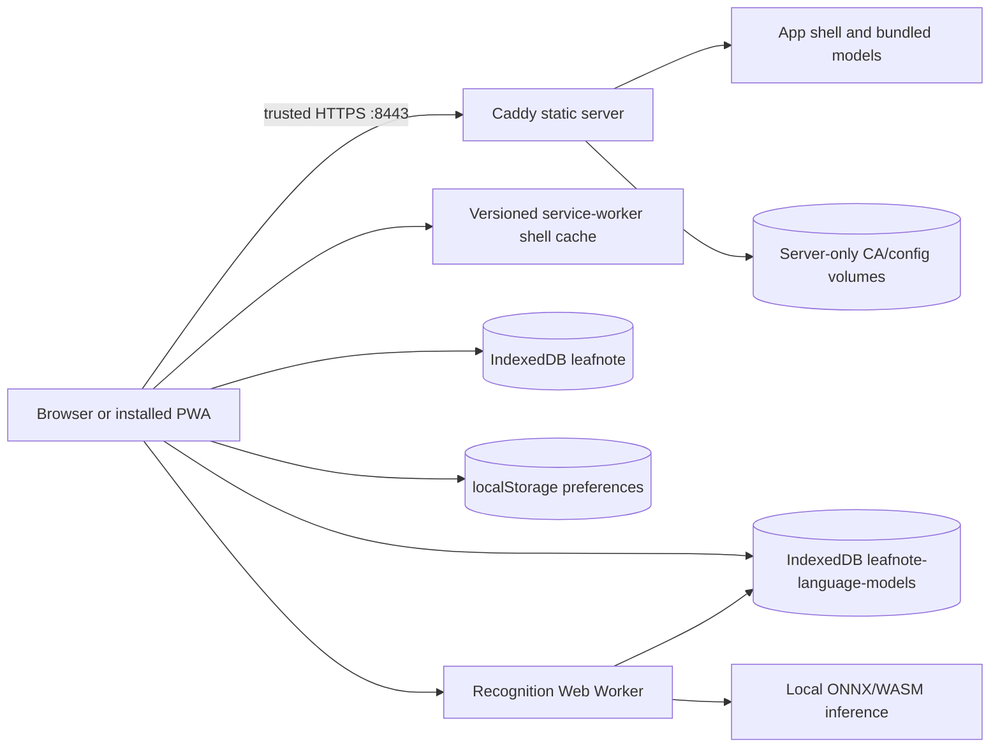
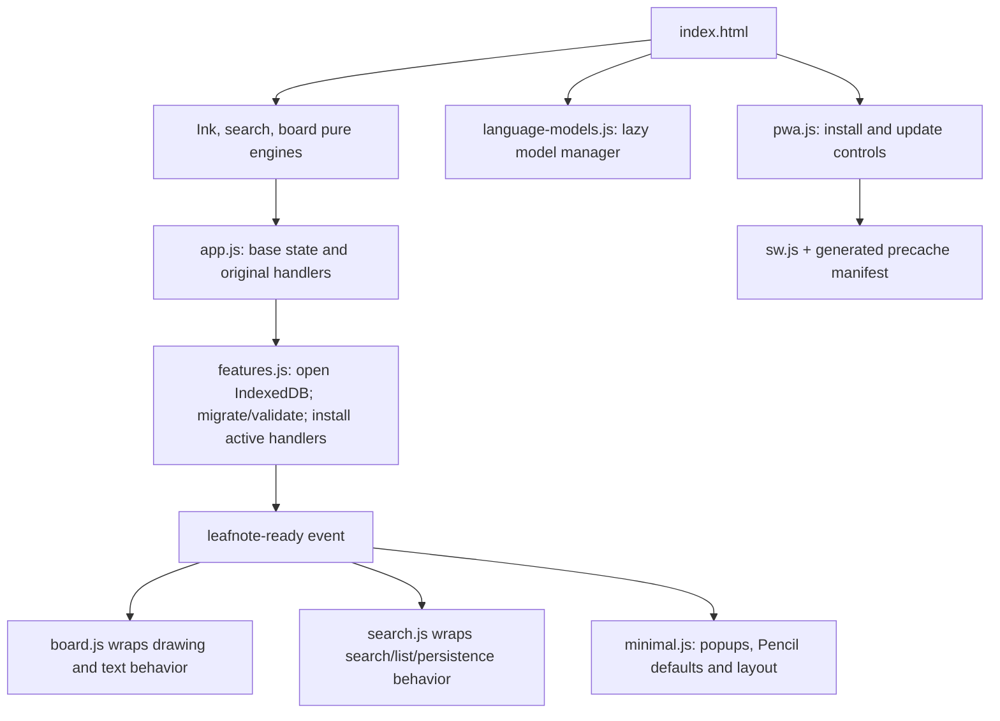
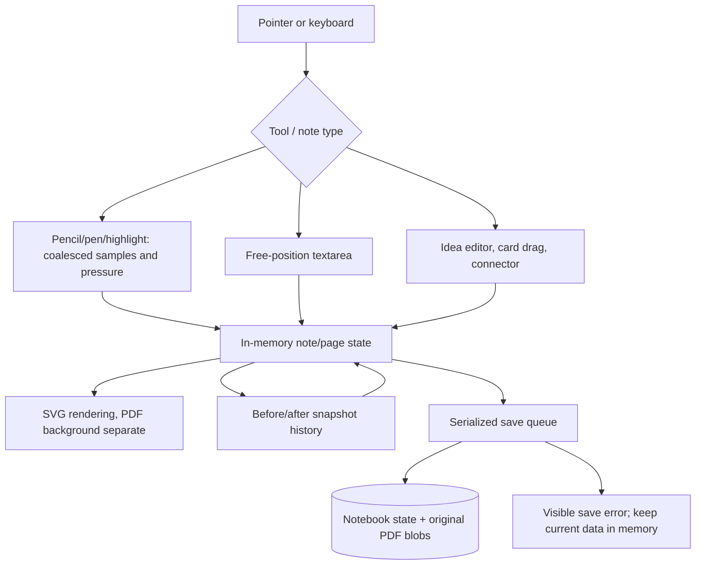
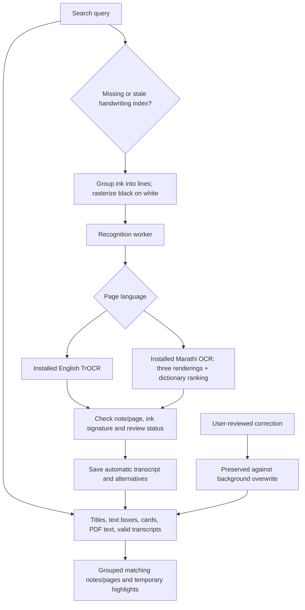

# Application flow and data boundaries

## Runtime overview



Notebook contents never travel to the container. The browser imports local PDFs and exports backups/downloads. Recognition consumes an RGBA line image in a worker on the client. Model source/licence links are informational; model installation fetches bundled files from the LAN server.

## Startup and script order



This is a buildless classic-script app with small ESM recognition/storage modules. `app.js` provides shared lexical bindings (`data`, `current`, `tool`, selectors, base functions). `features.js` replaces storage, drawing, export, undo, and note opening. Board and search modules wrap selected functions after readiness. Read the active override in `features.js` when a base function in `app.js` has the same name. This layering is documented rather than silently refactored during packaging.

## Editing, undo, and persistence



Coordinates are document-space values, independent of screen zoom. PDF annotations belong to a specific page. Pencil grade and opacity are retained as stroke fields. Formatting is plain text-box/card styling, not arbitrary rich HTML. Changing style preserves text, spacing, and undo history.

## Search and recognition



`search-engine.js` is the pure source of search records, normalization, line grouping, and ink signatures. `search.js` owns scheduling and the review UI. A transcript is stale when its recognition-relevant ink changes. Reviewed corrections survive recognizer upgrades. Marathi remains experimental; bundled sample checks are not an accuracy benchmark.

## Installation and updates

```mermaid
sequenceDiagram
  participant UI as App UI
  participant SW as Service worker
  participant Server as Local HTTPS server
  participant DB as Client IndexedDB
  UI->>SW: register
  SW->>Server: fetch complete versioned shell
  SW->>SW: cache all required shell files
  Note over SW: Install fails atomically if a required download fails
  UI->>UI: show offline-ready status
  Server-->>SW: later app version available
  SW->>SW: install new shell; wait
  UI->>DB: finish edit and await save
  DB-->>UI: saved
  UI->>SW: user-approved ACTIVATE_UPDATE
  SW->>SW: activate; remove older Leafnote shell caches only
  SW-->>UI: controller changed; reload saved app
```

The shell cache never stores note content or optional model assets. Models have their own install/remove lifecycle. The update handler refuses to reload if notebook persistence fails. Service-worker activation does not delete IndexedDB or layout preferences.

## Stored shapes

| Store                                 | Main contents                                                            | Owner               |
| ------------------------------------- | ------------------------------------------------------------------------ | ------------------- |
| `leafnote` / `state` / `notebook`     | notebooks, notes, PDF page metadata, text, ink, boards, transcripts      | `features.js`       |
| `leafnote` / `pdfs`                   | original imported PDF Blob by note ID                                    | `features.js`       |
| `leafnote-language-models` / `assets` | verified model/revision/file Blobs                                       | `model-storage.mjs` |
| `leafnote-language-models` / `models` | installed/removed state, revision, byte count                            | `model-storage.mjs` |
| `leafnote-shell-*` Cache API          | versioned static app runtime                                             | `sw.js`             |
| localStorage `leafnote-*`             | input, layout, writing, and text-style preferences; legacy recovery copy | app UI modules      |
| Docker `caddy_data`, `caddy_config`   | server TLS CA and Caddy metadata                                         | Caddy               |

`Note` includes stable ID, notebook ID, title, timestamps, favorite, paper, strokes and text boxes. PDF notes add page records and an original-file ID. Board notes add dimensions, nodes, and links. A stroke has color, width, opacity, pressure and sampled points; Pencil adds brush/grade. Text boxes and idea cards retain color, size and line height. Undo snapshots are in memory; exported backups carry persistent note/PDF data, not installed model files or shell caches.

No backend API, server-side authentication, note synchronization, collaboration, or cross-device data replication is introduced by containerization.
